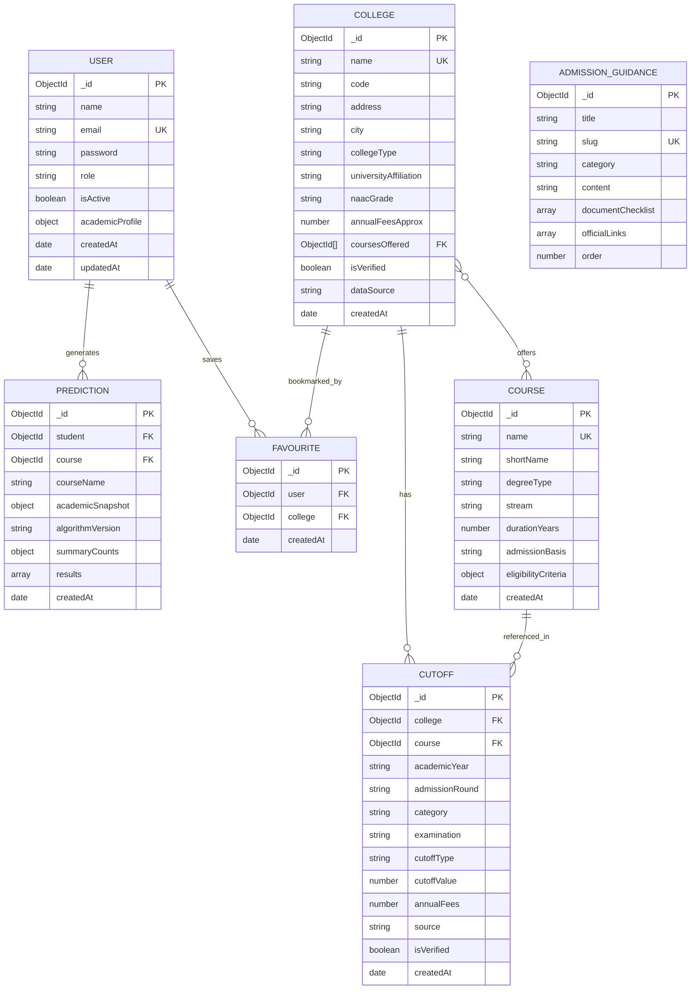

# AdmitWise — Database Design Documentation

## 1. Overview
AdmitWise utilizes MongoDB with Mongoose ODM. The database model balances normalization for catalog entities (Colleges, Courses, Cutoffs) with denormalized point-in-time snapshots for historical prediction evaluations.

Database Name: `admitwise_db`

---

## 2. Entity Relationship Diagram (ERD)



---

## 3. Data Dictionary & Collections

### 3.1 Collection: `users`
| Field | Type | Required | Constraints / Default | Description |
|---|---|---|---|---|
| `_id` | ObjectId | Yes | Primary Key | Unique user identifier |
| `name` | String | Yes | Trim, Min 2, Max 80 chars | Student or Administrator full name |
| `email` | String | Yes | Unique, Lowercase, Regex | Account email address |
| `password` | String | Yes | Select: false, bcrypt hashed | Secure salted password hash |
| `role` | String | Yes | Enum: `['student', 'admin']` | Access control role (Default: `'student'`) |
| `isActive` | Boolean | Yes | Default: `true` | Account active / suspended toggle |
| `academicProfile` | Sub-document | No | Embedded Object | Student academic scores & target preferences |
| `createdAt` | Date | Yes | Default: `Date.now` | Account registration timestamp |

### 3.2 Collection: `colleges`
| Field | Type | Required | Constraints / Default | Description |
|---|---|---|---|---|
| `_id` | ObjectId | Yes | Primary Key | College record ID |
| `name` | String | Yes | Unique, Trim | Full institutional title |
| `code` | String | No | Trim | DTE or University College Code |
| `city` | String | Yes | Indexed | Geographic city (e.g. Mumbai, Thane) |
| `collegeType` | String | Yes | Enum: Autonomous, Govt, Private-Aided, etc. | Administrative classification |
| `universityAffiliation` | String | Yes | Default: 'University of Mumbai' | Affiliated university body |
| `naacGrade` | String | No | Enum: A++, A+, A, B++, B+, B, C, Pending | National Accreditation Assessment grade |
| `annualFeesApprox` | Number | No | Min: 0 | Approximate benchmark fees |
| `coursesOffered` | ObjectId[] | No | Refs to `courses` | Array of offered degree programs |
| `isVerified` | Boolean | Yes | Default: `true` | Verification indicator against official brochure |
| `dataSource` | String | Yes | Default text | Data provenance statement |

### 3.3 Collection: `courses`
| Field | Type | Required | Constraints / Default | Description |
|---|---|---|---|---|
| `_id` | ObjectId | Yes | Primary Key | Course record ID |
| `name` | String | Yes | Unique, Trim | Full degree title (e.g. B.Sc. IT) |
| `shortName` | String | Yes | Trim | Display abbreviation |
| `stream` | String | Yes | Enum: IT, CS, Engineering, Management, Commerce | Domain branch |
| `durationYears` | Number | Yes | Min: 1, Max: 6 (Default: 3) | Course duration in academic years |
| `admissionBasis` | String | Yes | Enum: `HSC_MERIT`, `ENTRANCE_EXAM` | Admission determination mechanism |
| `eligibilityCriteria` | Object | Yes | Embedded Object | Minimum HSC %, Maths requirement, allowed streams |

### 3.4 Collection: `cutoffs`
| Field | Type | Required | Constraints / Default | Description |
|---|---|---|---|---|
| `_id` | ObjectId | Yes | Primary Key | Cutoff record ID |
| `college` | ObjectId | Yes | Ref: `College`, Indexed | Associated college reference |
| `course` | ObjectId | Yes | Ref: `Course`, Indexed | Associated course reference |
| `academicYear` | String | Yes | e.g. "2024-2025" | Academic intake year |
| `admissionRound` | String | Yes | Enum: Round 1, Round 2, Round 3, Spot | Allocation round |
| `category` | String | Yes | Enum: Open, OBC, SC, ST, EWS, TFWS | Reservation category |
| `cutoffType` | String | Yes | Enum: PERCENTAGE, PERCENTILE, RANK | Unit of comparison |
| `cutoffValue` | Number | Yes | Min: 0 | Closing cutoff score |
| `annualFees` | Number | No | Min: 0 | Course-specific annual fee |
| `source` | String | Yes | Text | Documented university / merit list source |

**Compound Index:**
```javascript
{ college: 1, course: 1, academicYear: 1, admissionRound: 1, category: 1, quota: 1 } // Unique
```
Prevents duplicate entries across identical college, course, year, round, and reservation quotas.

### 3.5 Collection: `predictions`
Preserves an immutable point-in-time snapshot of the student's marks and the resulting recommendations so that future changes to college records do not distort historical reports.

---

## 4. Integrity and Security Considerations
1. **Password Protection:** Schema level `select: false` prevents accidental exposure in queries or serialization.
2. **Cascade Safety:** Deleting a college cascades to delete associated cutoffs, preventing orphaned data records.
3. **Compound Key Deduplication:** Favourites enforce a unique compound index on `{ user: 1, college: 1 }`.
