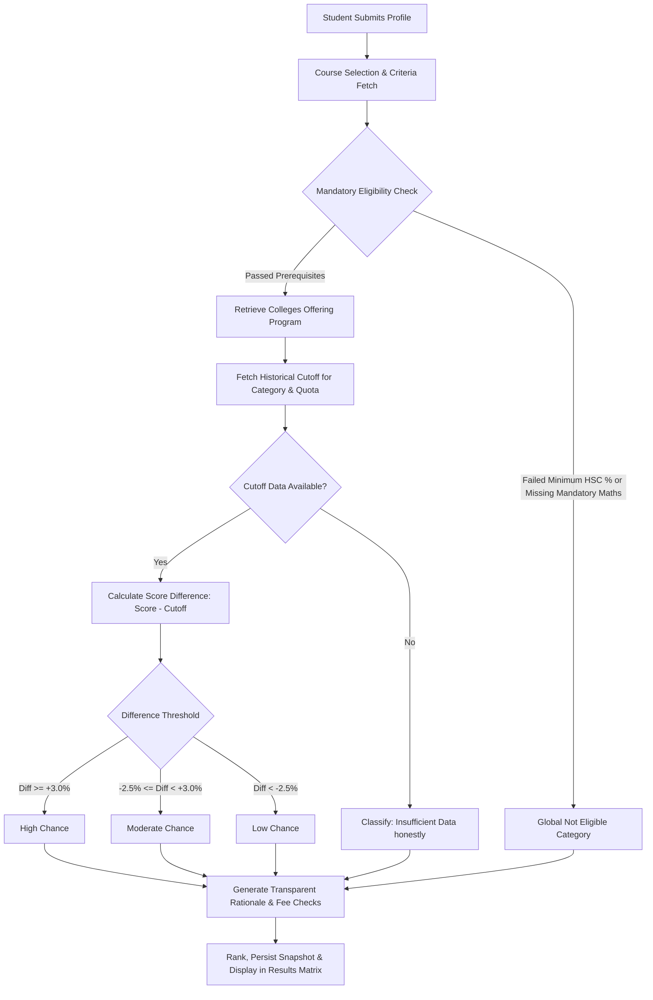

# AdmitWise — BSc IT Project Viva Examination & Architecture Guide

This guide is designed to prepare BSc Information Technology students for college project demonstrations, external examiner reviews, and viva voce examinations.

---

## 1. Executive Summary & Pitch (Examiner's Question: "What have you built and why?")
> **Viva Answer:**
> *"AdmitWise is a full-stack college admission prediction and recommendation system tailored for undergraduate aspirants in Mumbai and Maharashtra. We identified that commercial admission portals either act as lead-generation aggregators or use opaque black-box percentages that mislead students. Furthermore, students frequently apply to degree courses like B.Sc. IT without knowing that Mathematics in HSC is a mandatory university prerequisite.
>
> In AdmitWise, we engineered a deterministic, rule-based recommendation engine that enforces university prerequisites, evaluates candidate scores against authentic historical cutoff records across merit rounds and reservation categories, and transparently explains the exact mathematical reasons behind every prediction."*

---

## 2. Why Rule-Based Logic Over Machine Learning? (Examiner's Question: "Why didn't you use Machine Learning or Deep Learning?")
> **Viva Answer:**
> 1. **Explainability & Trust:** In college admissions, an opaque probabilistic output (e.g. *"74.2% chance"*) cannot be justified to a student or parent. If a student asks *why* they have a high or low chance, our rule-based system points directly to the cutoff differential: *"Your score of 84.5% is 4.5% above the 2024 Round 1 cutoff of 80.0% for the Open category."*
> 2. **Non-Stationary Distribution:** College cutoffs are not smooth statistical distributions. They are hard thresholds defined by the seat matrix, applicant volume, and university quotas. In many years, cutoffs shift by arbitrary margins due to board exam evaluation changes. A neural network would overfit to past noise.
> 3. **Data Scarcity vs Data Fabrication:** Merit lists consist of a few thousand discrete cutoff records per year, not millions of training points. Training a machine learning model on limited data leads to hallucinated cutoffs.
> 4. **Strict Eligibility Guardrails:** ML classification models can inadvertently classify a candidate as having a 60% chance of admission even if they failed Mathematics. Our rule-based architecture strictly evaluates mandatory eligibility *first*, flagging them as "Not Eligible" before any cutoff evaluation occurs.

---

## 3. The Prediction Algorithm (Step-by-Step Viva Explanation)

### Mathematical Thresholds:
1. **High Chance:**
   $$\text{Score Difference} = \text{Candidate Score} - \text{Cutoff Value} \ge +3.0\%$$
   *Candidate is comfortably above past merit round closing marks.*
2. **Moderate Chance:**
   $$-2.5\% \le \text{Score Difference} < +3.0\%$$
   *Candidate is within close range of Round 1 cutoffs. Subsequent merit rounds (Round 2 and Round 3) historically decline by $1\% \text{ to } 3\%$.*
3. **Low Chance:**
   $$\text{Score Difference} < -2.5\%$$
   *Candidate is substantially below closing cutoffs for early rounds.*
4. **Insufficient Data:**
   *When authentic historical cutoff records are missing for a college/category, the system discloses this limitation honestly rather than guessing.*
5. **Not Eligible:**
   *When statutory requirements (e.g., minimum HSC aggregate or mandatory subject) are unsatisfied.*

---

## 4. Key Technical Questions & Prepared Answers

### Q1: "How do you protect administrator routes?"
> **Answer:** *"All administrative routes (`/api/admin/*`) pass through two chained Express middleware functions: `requireAuth` and `requireAdmin`. First, `requireAuth` extracts the JWT from the HTTP-only cookie or Authorization header and verifies the signature using `jsonwebtoken`. Next, `requireAdmin` checks if `req.user.role === 'admin'`. If unauthorized, it terminates the request with HTTP 403 Forbidden. On the frontend, React Router protects admin pages using the `<ProtectedRoute requireAdmin={true}>` component."*

### Q2: "How is student password security handled?"
> **Answer:** *"Passwords are never stored in plain text. We utilize `bcryptjs` with a cost factor (salt rounds) of 10 inside a Mongoose `pre('save')` hook. In addition, the password field is marked with `select: false` in the Mongoose schema so queries and JSON responses never inadvertently leak password hashes."*

### Q3: "What prevents duplicate cutoffs or duplicate favourite colleges?"
> **Answer:** *"At the database level, we enforce compound unique indexes in MongoDB:
> - For Cutoffs: `{ college: 1, course: 1, academicYear: 1, admissionRound: 1, category: 1, quota: 1 }` with `{ unique: true }`.
> - For Favourites: `{ user: 1, college: 1 }` with `{ unique: true }`.
> At the controller level, Mongoose duplicate key error (code 11000) is caught and transformed into a user-friendly HTTP 409 Conflict response."*

### Q4: "How does the PDF generation service work?"
> **Answer:** *"The PDF service is implemented on the backend using `pdfkit`. When the student clicks 'Download PDF Report', a request is sent to `GET /api/predictions/:id/pdf`. The server populates the immutable prediction snapshot from MongoDB, constructs a vector layout with AdmitWise branding, applicant scores, comparison table, and educational disclaimers, and pipes the PDF stream directly to the client response with appropriate `Content-Disposition: attachment` headers."*

---

## 5. Potential Future Enhancements
- **Multi-State Expansion:** Adding cutoffs from Karnataka (KCET) and Delhi University (CUET).
- **Automated Scraping Pipeline:** Web scrapers to ingest PDF merit lists directly from college websites into the verification staging queue.
- **SMS / Email Alerts:** Automated notifications when colleges publish Round 2 and Round 3 merit lists.
